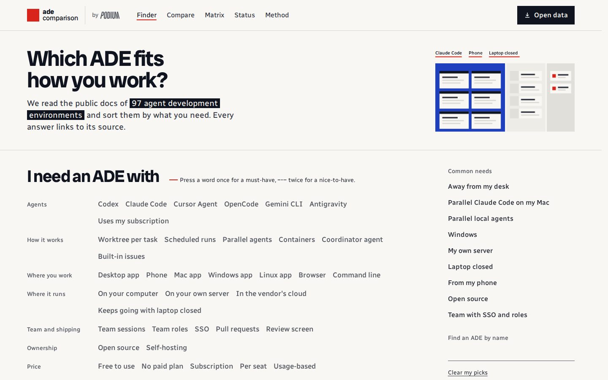

# adecomparison.com

[](https://adecomparison.com)

Which agent development environment (ADE) fits the way you work? adecomparison.com lists 500+ ADEs and compares them in depth from public sources, with a link behind every answer.

**[adecomparison.com](https://adecomparison.com)**: pick what you need (operating system, parallel agents, phone access, price, where it runs) and see which ADEs fit, which fit partly, and what each one is missing.

## For agents

Don't scrape the pages. Everything is published as static files:

- [`/llms.txt`](https://adecomparison.com/llms.txt): the map, start here
- [`/products/index.json`](https://adecomparison.com/products/index.json): every ADE, with links to its files
- `/products/<id>.json` and `.md`: one ADE's findings, each with its source and check date
- [`/data/facets.json`](https://adecomparison.com/data/facets.json): what each filter means

## How it's made

1. **Read.** Each ADE's docs, repository and release notes are read and the answers recorded.
2. **Source.** Every answer links to the public page it comes from, with the date it was checked.
3. **Check.** Findings are checked for source, scope and age before they're published. Some are also cross-checked by a second reviewer.
4. **Rank.** ADEs that meet all your must-haves come first. No overall score, and no placement advantage for anyone, the publisher included.

Unknown stays unknown: if a product doesn't say, the site says "unknown", never "no".

### The research system

Every ADE is researched against the same rules, and they're all in this repo:

- [**Comparison framework**](research/comparison-framework.md): the 51 criteria every ADE is judged on, what counts as evidence, and what doesn't
- [**Research rules**](research/AGENTS.md): how researchers and reviewers record, scope and recheck findings
- [**Criteria**](research/criteria.json) and [**schema**](research/schema.json): the same rules in machine-readable form, enforced by `npm run research:validate`
- [**Publication**](research/publication/README.md) and [**directory**](research/directory/README.md) contracts: which findings may go public, and how they become filters on the site

The [research catalog](research/README.md) explains how the pieces fit together.

The site is published by [Podium](https://adecomparison.com/method/), which also makes an ADE. The same rules apply to Podium as to everyone else, and the [Method page](https://adecomparison.com/method/) discloses the conflict in full.

## Corrections and contributions

Found something wrong or a missing ADE? Use **Report wrong data** or **Suggest a missing ADE** on any page, or [open an issue](https://github.com/madeinorbit/ade-comparison/issues/new/choose) with:

- the product,
- what's wrong,
- a link to a public page and the exact sentence that says so.

That quote is what we need. Word of mouth and private messages don't count, and vendors get no exception.

Pull requests are welcome, too. Each ADE is one file, `research/products/<id>.json`. Change the finding there, put the source URL and the exact quote in the PR description, then check it:

```sh
npm run research:validate   # checks the evidence rules
npm run data:build          # regenerates data/ from research/
```

Don't edit `data/` by hand; it's generated. Code and design PRs are welcome as well. Details in [CONTRIBUTING.md](CONTRIBUTING.md).

## What's in this repo

The whole site, its data and the research behind it:

- `research/`: the research catalog, one file per ADE, with every source and review
- `data/`: the public data package, generated from `research/`
- `media/`: screenshots
- `src/`: the Astro site

```sh
npm ci && npm run build && npm run preview
```

Building, testing and deploying: [docs/development.md](docs/development.md).

## License

Code: Apache-2.0. Data: CC BY 4.0, see [DATA-LICENSE.md](DATA-LICENSE.md). Screenshots belong to their owners.
